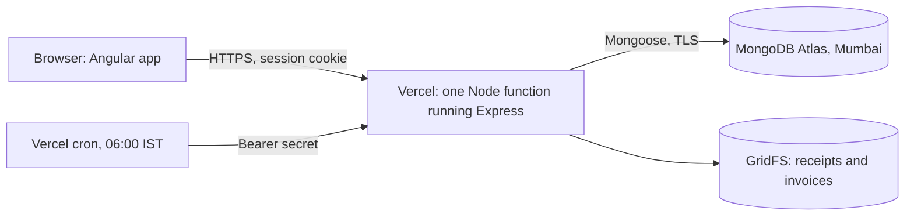

# Budget Utilization Monitor: project report

**Live app:** https://budget-monitor-eight.vercel.app
**Stack:** MongoDB, Express, Angular, Node.js (MEAN), deployed on Vercel with MongoDB Atlas
**Author:** Aditya Belhekar

## 1. Summary

Government budgets are allocated at the start of the financial year, but the money is often spent unevenly. Some heads sit idle for months and then rush their spending in March. Others run past their allocation early. By the time a yearly report shows the problem, the year is over.

The Budget Utilization Monitor tracks each budget head against the calendar. For every head it compares two numbers: how much of the financial year has passed, and how much of the allocation has been spent. When they drift apart, or a payment looks unusual, the system raises an alert, names the evidence and keeps it until someone acknowledges or resolves it.

The app runs on real public data: 90 months of Union Government accounts, April 2019 to September 2026, published by the Controller General of Accounts (CGA). Every figure in the database links back to the CGA page it came from.

## 2. Objectives

| Requirement from the brief | How the project meets it |
| --- | --- |
| MEAN stack only | MongoDB (Atlas), Express 5, Angular 22, Node.js 24. No other framework or database. |
| At least 7 interconnected pages | Overview, Department, Budgets, Expenditure, Alerts, Reports and Administration, plus sign-in. Every head, alert and report links to the others. |
| Real public data, nothing random | CGA "Accounts at a Glance" monthly figures for six budget heads, stored with source URLs. |
| Strict role-based access | Admin, Finance Officer and Department Head, checked on the server for every route. |
| Accurate, validated calculations | Money is stored as whole paise. Totals reconcile to the paisa against the published figures, and the test suite checks it. |
| Detect under-utilization, spikes and deviations | Seven rules, including a statistical spike test, run after every change and once a day. |
| Alerts, dashboards, reports, admin panel, audit logs | All built. Reports export as PDF and CSV. Every write is recorded in an append-only audit log. |
| Live deployed link | https://budget-monitor-eight.vercel.app |

## 3. Users and roles

The three roles are deliberately separate, so no single person can both set a budget and spend against it.

| Action | Admin | Finance Officer | Department Head |
| --- | --- | --- | --- |
| View the overview, department pages and reports | All heads | All heads | Own department only |
| Create budgets, revise allocations | Yes | No | No |
| Record expenditure, import CSV, attach documents | No | Yes | Own department only |
| Reverse a wrong entry | No | Yes | No |
| Acknowledge or resolve alerts | No | Yes | Own department only |
| Manage users and departments | Yes | No | No |
| Set alert thresholds, run a scan | Yes | No | No |
| Read the audit log | Yes | Yes | No |

The Angular guards only hide pages a role cannot use. The real checks run on the server: every request reloads the user from the database, confirms the account is still active and checks the role and department before any data is read or written.

## 4. The data

**Source.** The CGA publishes the Union Government's accounts every month as "Accounts at a Glance". Each page gives, for every major head, the budget estimate (or revised estimate) and the actual spending so far in the year.

**Heads tracked.** Food Subsidy, Nutrient Based Fertilizers Subsidy, Urea Subsidy, Petroleum Subsidy, Interest Payments, and Capital Expenditure. These are CGA budget heads; the administering department shown for each is our mapping, and the app says so.

**Extraction.** [`data/extract-cga.mjs`](../data/extract-cga.mjs) reads the saved CGA pages and writes [`data/cga-monthly.csv`](../data/cga-monthly.csv): 540 rows (90 months × 6 heads), each with its source URL and the percentage CGA itself published, which is used as a cross-check.

**Loading.** CGA publishes year-to-date totals. The seed script turns them into monthly amounts (this month's total minus last month's), loads them in one database transaction and then checks that the monthly amounts add back up to every published year-to-date figure, to the paisa. If anything is off by one paisa, the load is rolled back.

**Revisions.** Allocations change during the year when the revised estimate is published. Each budget keeps its full revision history, so the dashboard for any past date uses the allocation that was in force on that date, not today's.

## 5. Architecture

- **Client** ([`client/`](../client)): Angular 22 standalone components using signals, with no extra UI library. Charts are drawn by hand in SVG.
- **Server** ([`server/src/`](../server/src)): Express 5 API. It validates every input with zod at the boundary. Sessions are stored in MongoDB (connect-mongo) and the cookie is httpOnly, Secure and SameSite=Strict.
- **Deployment:** Vercel serves the built Angular files as static assets. It sends every `/api` request to one serverless function, [`api/index.js`](../api/index.js), which runs the same Express app. The function and the database are both in Mumbai.
- **Scheduled scan:** a Vercel cron calls `/api/cron/scan` every morning at 06:00 IST, authenticated with a secret compared in constant time.

## 6. The seven pages

1. **Overview.** One sentence states the finding (for example, "Two of six budget heads are off pace"). Next to it are the pace rings: the outer ring is the share of the year that has passed, the inner ring is the share of money spent. Below are a month picker, a table of heads sorted by how far each is from pace, a cumulative spending trend against an even-pace line, and a breakdown of where each rupee went.
2. **Department.** One head in depth: its rings, monthly spending bars, cumulative spending against an even pace, its open alerts and its projects.
3. **Budgets.** The list of budgets by financial year, each with its allocation history. Admins create budgets and revise allocations, and every revision needs a written reason.
4. **Expenditure.** Finance Officers and Department Heads record payments, import a CSV file of payments, attach a PDF or image receipt and (Finance only) reverse a wrong entry.
5. **Alerts.** Every finding with its evidence and severity. Users acknowledge or resolve an alert with a note.
6. **Reports.** Utilization, transaction and alert reports for any year and month, on screen or downloaded as PDF or CSV.
7. **Administration.** Users, departments, alert thresholds (with a preview of what a change would raise before it is saved) and the audit log.

## 7. Data model

| Collection | Holds |
| --- | --- |
| `users` | Name, email, bcrypt password hash, role, department, active flag |
| `departments` | Code, name, parent, note on the mapping |
| `budgets` | Department, financial year, allocation in paise, revision history, spent in paise |
| `transactions` | Amount in paise, date, category, vendor, reference, source (manual, CSV or CGA). Append-only. |
| `alerts` | Budget, type, period, severity, evidence frozen at first detection, status, notes |
| `thresholds` | The admin's overrides of the default rule limits |
| `auditlogs` | Who did what, when, with the before and after values. Append-only. |

"Append-only" is enforced in the models: any attempt to update or delete a transaction or an audit record throws an error. A mistake is corrected by a reversing entry, which keeps the original's date and can only be made once per transaction.

## 8. Calculations

**Money is never a floating-point number.** Amounts are stored as whole paise (₹1 = 100 paise) and checked with `Number.isSafeInteger`. Rupee input such as `"1,25,000.50"` is parsed digit by digit from the string, so `0.1 + 0.2` errors cannot creep in.

**Financial year.** April to March, evaluated in India time (Asia/Kolkata), so a payment made at 1 a.m. on 1 April is counted in the new year even though the server runs on UTC.

**Pace.** For a date *d* in the year:

- Year passed = day of the year ÷ days in the year (365 or 366)
- Utilization = spent ÷ allocation in force on *d*
- Gap in points = utilization − year passed
- Gap in rupees = spent − allocation × (day of the year ÷ days in the year)

A head is **behind** when the gap is below −15 points, **ahead** above +15, and **over** when it has spent more than its allocation. Otherwise it is **on pace**.

**As-of date.** CGA publishes about a month late. For heads fed by CGA data, the time-based rules are judged at the last published month, not today, so a head is not flagged as idle just because the next report has not come out yet.

**Worked example (real CGA figures, kept as a test).** On 31 December 2024 the year is 275 of 365 days, or 75.34% gone. Petroleum Subsidy had ₹11,925.01 crore allocated and ₹6,879.23 crore spent: a utilization of 57.69%, a gap of −17.65 points, and ₹2,105.37 crore less spent than an even pace. It is behind pace and is flagged. Food, Urea and Nutrient Based Fertilizers are checked on the same date; Fertilizers is flagged as ahead and the other two stay quiet.

## 9. Detection rules

Each rule has a default threshold that an Admin can change. A preview shows what the new limits would raise before they are saved.

| Rule | Raised when (default limits) |
| --- | --- |
| Under-utilization | At least 70% of the year has passed and less than 40% of the allocation is spent |
| Pace deviation | After the first 25% of the year, utilization is more than 15 points from the year passed |
| Overspending | Spending reaches 90% of the allocation (warning), or exceeds it (critical) |
| Dormant funds | No spending for 45 days while at least 25% of the allocation is still unspent |
| Year-end rush | More than 33% of the year's spending falls in January to March, or more than 15% in March alone |
| Possible duplicate | Two payments of the same amount in the same category within 7 days |
| Spending spike | A month's spending is far outside the head's own history, or one payment is more than 10% of the allocation |

**The spike test.** A month is compared with up to 24 earlier months of the same head using the modified z-score: 0.6745 × (this month − median) ÷ MAD, where MAD is the median absolute deviation. A score above 3.5 is a spike. Medians are used instead of the mean and standard deviation, so one huge month does not hide the next one. The test needs at least 6 months of history and leaves March out, because March is always high for accounting reasons and would set off false alarms.

**One alert per finding.** An alert is keyed by budget, rule and period. Finding the same problem again raises its severity instead of creating a duplicate, and the evidence (figures, dates and limits) is frozen at first detection so it cannot change under the reviewer. A resolved alert stays resolved.

**When rules run.** After every write (a new payment, an import, a reversal, a budget revision), on demand by an Admin, and every morning by the cron. When the data is first loaded, the 90 months are replayed in order so the alert history matches what the system would have raised at the time: 134 alerts on the live site.

## 10. Reports

Three reports, each for any financial year and month: budget utilization, transactions and alerts. Each can be viewed on screen, or downloaded as CSV or as a PDF built with pdfkit. CSV cells that begin with `=`, `+`, `-` or `@` are prefixed with an apostrophe, so a vendor name cannot run as a formula when the file is opened in Excel.

## 11. Security

- Passwords: bcrypt with cost 12, at least 12 characters and at most 72 bytes (the bcrypt limit, refused rather than silently cut). A wrong email takes as long to check as a wrong password, so attackers cannot tell which emails exist.
- Sign-in is limited to 10 attempts per 15 minutes. The session ID is regenerated on sign-in.
- Server-side sessions; the cookie cannot be read by scripts or sent from other sites.
- Helmet sets a strict Content Security Policy and the other security headers.
- Every input is validated with zod before it reaches the database. Object IDs, dates, amounts and file types are all checked.
- Uploaded files are identified from their contents, not their name, and only PDF, JPEG and PNG are accepted, up to 4 MB.
- Every money write runs in a MongoDB transaction: the payment, the budget totals and the audit record are saved together or not at all.
- Secrets live only in Vercel's encrypted environment settings, never in the repository.

## 12. Audit log

Every create, update, revision, reversal, import, alert action, threshold change and user change writes an audit record in the same transaction as the change. The record holds the actor, the action, the before and after values and the time. Records cannot be edited or deleted. Admins and Finance Officers can filter and read them on the Administration page.

## 13. Design

The interface follows a "Gov × Apple" direction: calm, precise and readable, without official emblems, so it is never mistaken for a real government site.

- Source Serif 4 for headlines and figures, the system font for controls.
- A stone-grey canvas with a navy accent. Three status colours, each checked for contrast: teal for money that is behind (idle), turmeric for ahead, red for over.
- Three levels of depth (shadow) and corner radii that shrink with hierarchy.
- The pace rings are the signature element: time passed against money spent, readable at a glance.
- On phones, the sidebar becomes a bottom tab bar. Light and dark themes follow the system setting.

## 14. Testing

168 automated tests (`npm test --prefix server`), run on GitHub Actions for every push:

- Every role against every route, including attempts to reach another department's data.
- Each detection rule just below, at and just above its threshold.
- The worked example above, as a fixture.
- Money parsing and rounding, financial-year boundaries and leap years.
- Reconciliation of the seeded CGA data to the paisa.
- CSV import (all-or-nothing, with row numbers in the errors) and the PDF and CSV report files.

## 15. Deployment

1. MongoDB Atlas free cluster in Mumbai, with a database user and TLS.
2. `npm run seed:data` loads the CGA figures and replays the alerts; `npm run seed:users` creates the three accounts.
3. Vercel builds the Angular app, serves it from its CDN and runs the API as one function in Mumbai (`bom1`), with the daily scan as a cron job.
4. A health check at `/api/health` confirms the deployment.

The setup is scripted in [`go-live.ps1`](../go-live.ps1), which can be run again safely.

## 16. Limitations and next steps

- CGA data is at the level of budget heads for the whole Union Government. A real deployment would connect to a ministry's own accounts system (for example PFMS) for department-level payments.
- CGA publishes about a month late, so the dashboard is only as current as the latest report. Payments entered by hand are current.
- The detection rules use fixed thresholds and a robust statistic. With several years of payment-level data, a seasonal model per head could replace the fixed year-end limits.
- Email or SMS notifications for critical alerts would be a natural next feature.

## 17. Links

- Live app: https://budget-monitor-eight.vercel.app
- Source code: this repository
- Data source: Controller General of Accounts, https://cga.gov.in
